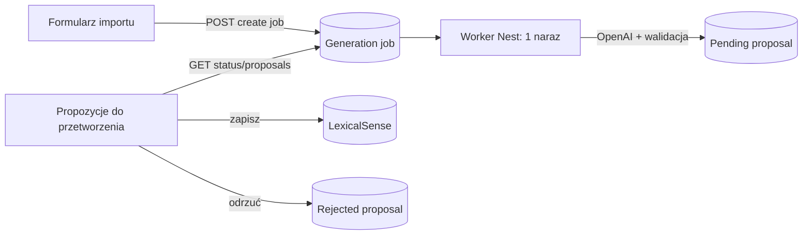

# Asynchroniczne generowanie LexicalSense

Status: implemented  
Created: 2026-10-26
Implemented: 2026-10-26 — spełniono wszystkie kryteria po doprecyzowaniu zakresu przez użytkownika; dlatego przeniesiono specyfikację do `implemented`.

Zakres doprecyzowany 2026-10-26: użytkownik wyłączył migrację wcześniejszych wyników AI oraz prezentację pełnych danych znaczenia w karcie propozycji.

## 📝 TLDR

Dotychczasowe synchroniczne generowanie blokowało formularz i przechowywało wynik roboczy w pamięci procesu. Zmiana wprowadza trwałe zadania oraz stronę „Propozycje do przetworzenia”: formularz natychmiast wraca do pracy, a każda niezapisana propozycja z nowych zadań pozostaje dostępna do zapisu albo odrzucenia.

Niedokończone zadania nie są wznawiane po restarcie. Zostają oznaczone jako nieudane i mogą być ręcznie ponowione.

## 📝 Problem Statement

Generowanie z `web_search` trwa minuty, więc obecny request blokuje interfejs. Wynik w `LexicalSensesService.drafts` znika po restarcie, a użytkownik nie może wysłać kilku partii i wrócić do nich później. `OpenAiGenerationResult` ma poprawne batch JSON-y, lecz nie śledzi decyzji nad pojedynczymi znaczeniami.

## 📝 Intended Behavior

- Kliknięcie generowania tworzy zadanie i zwraca `202 Accepted` z identyfikatorem, bez czekania na OpenAI.
- Wbudowany worker backendu realizuje zadania kolejno, używając obecnego wywołania OpenAI, walidacji i logowania.
- Każdy poprawny strukturalnie sens staje się osobną oczekującą propozycją; ostrzeżenia dowodowe pozostają ostrzeżeniami.
- Na osobnej stronie użytkownik widzi statusy zadań oraz wszystkie oczekujące propozycje.
- Zapisana propozycja znika z tej listy; odrzucona trafia do osobnej tabeli; bez decyzji pozostaje widoczna.

## 📝 Proposed Solution

Pozostawić SQLite i jeden proces Nest, bez dodatkowego brokera. BullMQ wymaga Redis, a Graphile Worker PostgreSQL, więc oba rozwiązania dodałyby infrastrukturę niezgodną z obecną aplikacją ([BullMQ](https://docs.bullmq.io/guide/connections), [Graphile Worker](https://worker.graphile.org/docs)).

Tabele Prisma są trwałą kolejką, a worker w `LexicalSensesService` wykonuje jedno zadanie naraz. Przy starcie aplikacji rekordy `queued` i `running` przechodzą na `failed/server_restarted`; nie ma automatycznych ponowień. Przycisk „Ponów” tworzy nowy job z tym samym wejściem. Dotychczasowy `draftId` i pamięciowy `Map` są zastąpione trwałymi propozycjami.

## 📝 Architecture

Wniosek: job wykonuje partię, a propozycja reprezentuje decyzję użytkownika; żadna część przepływu nie zależy od otwartej karty.

- `LexicalSensesService` sprawdza wejście, tworzy zadania, atomowo przejmuje najstarsze `queued`, wywołuje OpenAI i obsługuje restart.
- Worker zapisuje wyłącznie sparsowany Structured Output. Koperta Responses API pozostaje tylko w logach backendu.
- Strona importu po `202` odblokowuje formularz i podaje link do propozycji.

## 📝 Data Model

Szczegółowy graf: [data-model-graph.md](../../data-model/2026-10-26-asynchronous-lexical-sense-generation.md).

### `LexicalSenseGenerationJob`

`id`, `status` (`queued`, `running`, `ready`, `failed`), `itemsJson`, `resultJson?`, `validationJson?`, `errorCode?`, `errorMessage?`, daty utworzenia/startu/zakończenia. Indeks `status, createdAt` zapewnia pobranie najstarszego zadania. `resultJson` zawiera wyłącznie batch Structured Output, nie kopertę API.

### `LexicalSenseGenerationProposal`

`id`, `jobId`, `senseJson`, `validationWarningsJson?`, `createdAt`. Rekord istnieje tak długo, jak długo użytkownik nie zdecyduje o sensie. Dopasowania z bazą liczone są przy odczycie i ponownie przy zapisie.

### `RejectedLexicalSenseProposal`

`id`, `sourceProposalId`, `jobId`, `senseJson`, `validationWarningsJson?`, `rejectedAt`. Odrzucenie w transakcji tworzy ten rekord i usuwa oczekującą propozycję. Tabela utrwala świadomą decyzję, aby ten sam rekord nie wrócił po odświeżeniu; w tym zakresie nie dostaje osobnego widoku, przywracania ani usuwania.

Migracja tworzy trzy tabele. Wcześniejsze wyniki AI nie są przenoszone do kolejki propozycji.

## 📝 API Contracts

| Metoda | Kontrakt |
| --- | --- |
| `POST /api/lexical-senses/generation-jobs` | Przyjmuje obecne `items` i `checkId`; tworzy job i zwraca `202 { id, status: "queued" }`. |
| `GET /api/lexical-senses/generation-jobs` | Zwraca stany `queued`, `running`, `ready`, `failed`, bez koperty OpenAI. |
| `POST /api/lexical-senses/generation-jobs/:id/retry` | Tylko dla `failed`; tworzy nowy `queued` job z tym samym wejściem. |
| `GET /api/lexical-senses/generation-proposals` | Zwraca wszystkie oczekujące propozycje, ostrzeżenia i aktualne dopasowania. |
| `POST /api/lexical-senses/generation-proposals/:id/save` | Przyjmuje `definition_pl` i `confirmedDistinct`; sukces usuwa propozycję, konflikt pozostawia ją na liście. |
| `POST /api/lexical-senses/generation-proposals/:id/reject` | Transakcyjnie przenosi propozycję do tabeli odrzuconych; `204`. |

Stare `POST /generate` i `POST /save` zostają usunięte po przełączeniu UI; nie utrzymujemy dwóch źródeł prawdy.

## 📝 UI/UX

- Formularz importu po zleceniu pokazuje potwierdzenie i link „Przejdź do propozycji do przetworzenia”, a następnie jest gotowy do kolejnej partii.
- Nowa strona i pozycja nawigacji „Propozycje do przetworzenia” pokazuje statusy (`oczekuje`, `trwa`, `nieudane` z „Ponów”) oraz wszystkie oczekujące karty sensów. Nie jest to historia.
- Karta pokazuje hasło, część mowy oraz włoską i edytowalną polską definicję. Przy próbie zapisu podobnego znaczenia pokazuje wpisy z bazy i pozwala zdecydować o zapisie. Ma akcje „Zapisz” i „Odrzuć”.
- Po zapisie lub odrzuceniu znika tylko dana karta. Karta bez decyzji przeżywa odświeżenie strony i restart.
- Odrzucone rekordy nie są częścią tej strony ani osobnej historii UI w tym wdrożeniu; ich trwałość służy wyłącznie zachowaniu decyzji i wykluczeniu z kolejki oczekującej.

## 📝 Edge Cases & Failure Scenarios

- Restart przy `queued` albo `running`: startup oznacza job jako `failed/server_restarted`.
- Błąd OpenAI, timeout, walidacja lub baza: job przechodzi na `failed` z bezpiecznym komunikatem; detale są tylko w logach.
- Równoległe pętle: atomowe przejęcie `queued → running` oraz lokalna współbieżność 1 chronią przed podwójnym wykonaniem.
- Zmiana bazy podczas oczekiwania: zapis ponownie sprawdza duplikat i nie usuwa propozycji przy konflikcie.
- Brak sensów, ale `deferred`/ `coverage`: job jest `ready`, lecz nie tworzy pustych kart.

## 📝 Risks & Impact Review

SQLite i worker w tym samym procesie nie dają niezależnego wykonawcy ani skalowania poziomego. To jest świadomy minimalny zakres dla jednej aplikacji. Wymóg wznawiania po restartach lub wielu instancji wymaga późniejszego przejścia na zewnętrzną kolejkę, nie rozszerzania tej pętli.

Dojrzałe kolejki oferują retry/backoff ([BullMQ](https://docs.bullmq.io/guide/retrying-failing-jobs)), lecz tu ponowienie pozostaje ręczne, by nie uruchamiać kosztownego zapytania bez zgody użytkownika.

## 📋 Phasing

1. Trwały model joba i worker.
2. Zlecanie z formularza.
3. Propozycje oraz zapis/odrzucenie.
4. Testy oraz usunięcie starego stanu pamięciowego.

## 📋 Implementation Plan

### Phase 1 — trwała praca

1. Dodać modele Prisma i migrację; sprawdzić ją na kopii SQLite.
2. Wydzielić wykonanie OpenAI/walidacji do metody workera bez zmiany skilla i logów.
3. Dodać pojedynczego wykonawcę, atomowe przejęcie i reset stanów po starcie; przetestować stany oraz współbieżność.

### Phase 2 — zlecanie

4. Dodać API utworzenia/listy/retry jobów, zachowując weryfikację `checkId` wyłącznie przy utworzeniu.
5. Przełączyć formularz na `202`, odblokowanie wejścia i link do propozycji.

### Phase 3 — decyzje

6. Dodać API pending proposals oraz transakcyjne zapisanie/odrzucenie z obecnymi regułami duplikatów.
7. Dodać stronę i nawigację „Propozycje do przetworzenia”.

### Phase 4 — weryfikacja

8. Rozszerzyć test przepływu o `202`, wiele jobów, zapis i odrzucenie.
9. Dodać test restartu oraz retry.
10. Uruchomić build i testy z migracją w testowej bazie; usunąć `drafts` i stare endpointy.

## Acceptance Criteria

- [x] Tworzenie joba szybko zwraca `202`, bez oczekiwania na OpenAI.
- [x] Można utworzyć wiele zadań, a worker wykonuje je pojedynczo i trwale zapisuje status.
- [x] Strona po ręcznym wejściu/odświeżeniu pokazuje każdą niezapisaną i nieodrzuconą propozycję AI.
- [x] Zapis usuwa tylko tę propozycję z listy i nadal blokuje duplikat; odrzucenie przenosi ją do osobnej tabeli.
- [x] Brak decyzji pozostawia propozycję po odświeżeniu i restarcie.
- [x] Odrzucony rekord nie wraca do kolejki po odświeżeniu; jego przegląd, przywracanie i usuwanie są poza zakresem.
- [x] Po restarcie `queued/running` są widoczne jako nieudane i dają się ręcznie ponowić.
- [x] Baza nie przechowuje koperty Responses API ani sekretu.

## Open Questions

Brak blokujących.

## Related Records

- [Pierwotny import LexicalSense](2026-10-25-lexical-sense-import.md)
- [Audyt wyniku generowania](2026-10-25-openai-generation-audit.md)
