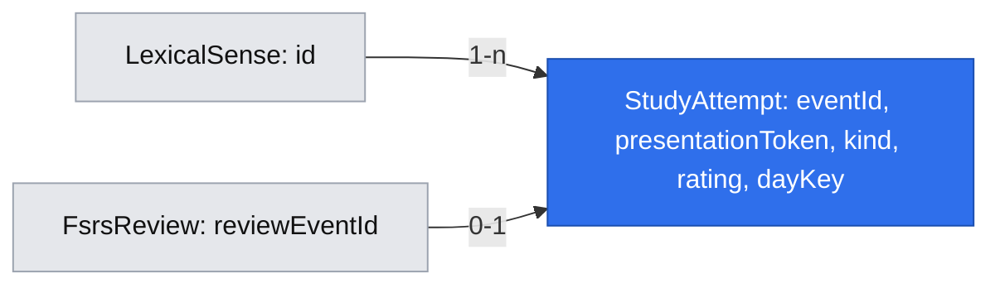

# Ekran „Nauka” i ocenianie LexicalSense

Status: implemented
Created: 2026-10-26
Implemented: 2026-10-26 — spełniono kryteria akceptacji i zweryfikowano wdrożenie lokalne.
Updated: 2026-10-26 — po zgłoszeniu błędu zmieniono kolejność utrwaleń nowych znaczeń; zobacz [naprawę kolejki](../../runs/2026-10-26-study-reinforcement-order.md).
Updated: 2026-10-26 — ograniczono lokalne utrwalenie do jednej dodatkowej próby po każdej formalnej ocenie `Again`; zobacz [naprawę pętli](../../runs/2026-10-26-limit-study-reinforcement.md).

## 📝 TLDR

Uczący się nie ma dziś ekranu, na którym zobaczy liczbę należnych powtórek i jeszcze nieuczonych `LexicalSense`, a następnie rozpocznie naukę. Ekran „Nauka” przeprowadza przez należne powtórki, ich utrwalenia po błędach, nowe znaczenia i dopiero potem utrwalenia nowych znaczeń. Użytkownik widzi cały wpis, ocenia go `Again`, `Hard`, `Good` lub `Easy` i może przerwać oraz wznowić pracę później. W tej iteracji materiałem jest sam `LexicalSense`; ćwiczenia generowane z jego użyciem należą do późniejszego etapu.

Ekran startowy pokazuje wyłącznie dwie liczby i działania. Nie wyświetla listy ani szczegółów dostępnych znaczeń przed rozpoczęciem sesji.

## 📝 Problem Statement

Usługa FSRS już zapisuje stan i termin po otrzymaniu gotowej oceny, ale aplikacja nie wybiera znaczeń do nauki ani nie udostępnia użytkownikowi przepływu oceniania. Bez tego nie da się przeprowadzić nauki i powtórek przez interfejs. Jednostką nauki jest `LexicalSense`, także wtedy, gdy kilka znaczeń należy do tego samego `LexicalItem`.

## 📝 Intended Behavior

- Jedna specyfikacja obejmuje ekran liczników i następujący po nim przebieg sesji; wdrożenie może być etapowe.
- Ekran startowy pokazuje wyłącznie liczbę należnych powtórek i liczbę znaczeń bez rozpoczętej nauki, bez listy znaczeń. Jedno działanie uruchamia lub wznawia naukę, jeśli dostępny jest choć jeden element.
- Do licznika i uruchomienia powtórek wchodzą terminy `dueAt <= teraz`. Przypięty FSRS-7 wyznacza również terminy minutowe w tym samym dniu, więc granicą jest bieżąca chwila, a nie koniec dnia.
- Użytkownik nie wybiera wielkości partii. System udostępnia wszystkie elementy w kolejności priorytetów i przyjmuje cztery oceny FSRS przez istniejącą usługę.
- Pierwsza ocena nowego znaczenia i każda ocena znaczenia ponownie należnego według `dueAt` aktualizują FSRS. Dodatkowe utrwalenie po błędzie, wykonane przed kolejnym `dueAt`, zmienia wyłącznie kolejkę sesji. To samo znaczenie może zatem mieć więcej niż jedną ocenę FSRS w ciągu dnia.
- Podczas sesji cały wpis `LexicalSense` jest widoczny od razu. W tym prototypie nie ma etapu odsłaniania odpowiedzi ani sprawdzania jej poprawności.
- Liczniki pozostają widoczne podczas sesji i aktualizują się po ocenach: pozostałe należne powtórki, pozostałe nowe znaczenia i utrwalenia wymagane po błędach w bieżącej sesji.
- Najpierw przechodzi przez należne powtórki i ich utrwalenia po błędach. Następnie pokazuje nowe znaczenia, a te ocenione jako `Again` wracają po pozostałych nowych znaczeniach. Po jednej dodatkowej próbie znaczenie czeka na termin FSRS także wtedy, gdy druga ocena to `Again`.
- Użytkownik może przerwać naukę w dowolnym momencie i wrócić później bez ponownego zaliczania ocenionych elementów.
- Wznowienie ponownie wylicza kolejkę z aktualnego stanu: terminy FSRS, utrwalenia należnych powtórek, nowe znaczenia, utrwalenia nowych znaczeń. Nie zachowuje dawnej kolejności, jeśli terminy zmieniły się podczas przerwy.
- Lista oczekujących utrwaleń nie przechodzi na kolejny dzień: o północy czasu `Europe/Warsaw` jest zerowana, a dostępność elementów wynika ponownie z terminów FSRS. Zapisane zdarzenia ocen pozostają w historii.
- Generowanie i rozwiązywanie ćwiczeń pozostaje poza zakresem tej specyfikacji.

## 📝 Research & Proposed Solution

[Anki](https://docs.ankiweb.net/deck-options.html) rozdziela nowe, należne i krótkie kroki nauki; po `Again` może wyznaczyć powtórkę po minucie. [Mnemosyne](https://mnemosyne-proj.org/help/getting-started.php) pokazuje błędne elementy ponownie po zaplanowanych powtórkach. Kolejka ma kolejność „terminowe → utrwalenia terminowych → nowe → utrwalenia nowych”, bez talii, limitów dziennych i odsłaniania odpowiedzi. W przypiętym `ts-fsrs@6.0.0-beta.15` `DefaultScheduler` może wyznaczyć więcej niż jeden `dueAt` tego samego dnia; reguła jednej oceny FSRS na dzień zignorowałaby te terminy ([dokumentacja biblioteki](https://github.com/open-spaced-repetition/ts-fsrs/blob/main/packages/fsrs/README.md)).

Backend wylicza liczniki i następny element z trwałego stanu, a przeglądarka prezentuje wynik. Bez stałej partii i kursora sesji: wznowienie jest nowym odczytem aktualnej kolejki. Dodatkowe utrwalenie po `Again` jest stanem aplikacji, nie nową powtórką FSRS przed `dueAt`.

## 📝 Architecture

Nowy `StudyService` korzysta z istniejących `LexicalSense`, `FsrsState` i `FsrsService`. Jest jedynym miejscem wyboru następnego znaczenia oraz klasyfikacji oceny; frontend nie oblicza priorytetów ani terminu FSRS. `FsrsService` nadal wykonuje obliczenie karty i zapis historii. Dla ocen formalnych trzeba udostępnić mu możliwość uczestniczenia w tej samej transakcji, która zapisuje zdarzenie sesji. Nie wolno kopiować wzoru FSRS do `StudyService`.

Po każdym odczycie lub ocenie backend wybiera pierwszą niepustą grupę:

1. `FsrsState.dueAt <= teraz`, najstarszy termin pierwszy (`dueAt`, potem `lexicalSenseId`). Obejmuje także krótkie kroki nauki i ponownej nauki wyznaczone przez FSRS.
2. Znaczenia ocenione dziś jako należne, których ostatnia ocena formalna to `Again` i które nie należą już do grupy 1 ani nie miały od niej lokalnego utrwalenia; najstarszy oczekujący błąd pierwszy.
3. Znaczenia bez `FsrsState`, według `createdAt`, potem `id`.
4. Znaczenia ocenione dziś jako nowe, których ostatnia ocena formalna to `Again` i które nie należą do grupy 1 ani nie miały od niej lokalnego utrwalenia; najstarszy oczekujący błąd pierwszy.

Formalne `Again` dodaje jedno oczekujące utrwalenie. Każda ocena tego utrwalenia, także `Again`, zdejmuje je z lokalnej kolejki; kolejna próba wynika z `dueAt` FSRS. `Hard` nie służy do oznaczania błędu ([Anki Manual](https://docs.ankiweb.net/deck-options.html)). Jeżeli przed lokalnym utrwaleniem nadejdzie termin `dueAt`, znaczenie wraca jako formalna powtórka FSRS. Aktualna karta nie jest rezerwowana na czas nieaktywności: po przerwie lub zmianie dnia backend ponownie sprawdza uprawnienie do oceny.

## 📝 Data Model

Dodajemy `StudyAttempt`: `eventId` (unikalny klucz ponowienia żądania), `lexicalSenseId`, `presentationToken` (do sprawdzenia zgodności ponowienia), `kind` (`new`, `due`, `reinforcement`), `rating`, `reviewedAt` (czas serwera UTC), `dayKey` (lokalny dzień `Europe/Warsaw`), opcjonalny unikalny `fsrsReviewEventId` dla oceny przekazanej do FSRS. Rekord wskazuje istniejący `LexicalSense`; formalna ocena wskazuje odpowiadający `FsrsReview`. Indeks `(dayKey, lexicalSenseId, reviewedAt)` pozwala znaleźć ostatnią ocenę danego znaczenia w dniu. `eventId` zapobiega podwójnemu naliczeniu również dla lokalnych utrwaleń.

Stan oczekującego utrwalenia wynika z ostatniego `StudyAttempt` danego znaczenia w aktualnym `dayKey`: `Again` po ocenie `new` lub `due` oznacza oczekiwanie; próba `reinforcement` wyczerpuje tę możliwość niezależnie od wyniku. O północy zmienia się `dayKey` aktywnej kolejki, więc wczorajsze błędy natychmiast przestają być dostępne; historia ocen nie jest kasowana. Nie powstaje tabela sesji ani kopia karty FSRS.

Relacja do `FsrsReview` występuje tylko dla `new` i `due`. Migracja wyłącznie dodaje tabelę i indeks; istniejące znaczenia, karty oraz historia FSRS pozostają bez zmian. Nie przechowujemy odpowiedzi OpenAI ani danych nowego użytkownika.

Wersja interaktywna grafu: [model danych ekranu Nauka](../../data-model/2026-10-26-study-screen.html).

## 📝 API Contracts

| Metoda | Kontrakt |
| --- | --- |
| `GET /api/study/overview` | Zwraca `dueCount`, `newCount`, `reinforcementCount` i najbliższy przyszły `nextDueAt`. Ekran startowy wyświetla tylko pierwsze dwie liczby; trzecia pozwala udostępnić wznowienie utrwaleń. |
| `GET /api/study/next` | Zwraca aktualne liczniki oraz jeden `candidate` albo `null`. Kandydat zawiera `lexicalSenseId`, pełny zapisany sens, `kind` (`due`, `reinforcement`, `new`) i token stanu potrzebny przy ocenie. Niczego nie zapisuje ani nie rezerwuje. |
| `POST /api/study/attempts` | Przyjmuje `{ eventId, lexicalSenseId, presentationToken, rating }`, gdzie `rating` jest jedną z czterech ocen FSRS. Czas oceniania nadaje serwer. Zwraca potwierdzenie, zaktualizowane liczniki i następny kandydat. |

Token jest warunkiem zgodności, a nie uprawnieniem: backend ponownie sprawdza sens, aktualny dzień, wersję karty FSRS i ostatnie zdarzenie sesji. Nie przyjmuje od klienta `kind`, `dueAt` ani gotowego stanu karty. Jeżeli kandydat stał się nieaktualny po ocenie w innej karcie przeglądarki, zwraca `409` i aktualny stan do odświeżenia. Jeżeli termin FSRS nadszedł podczas wyświetlania lokalnego utrwalenia tego samego znaczenia, serwer kwalifikuje przesłaną ocenę jako formalną powtórkę zamiast zapisywać ją lokalnie. Brak znaczenia daje `404`, błędna ocena lub identyfikator `400`.

`eventId` jest trwałym kluczem idempotencji: identyczne ponowienie zwraca wcześniejsze potwierdzenie bez nowej oceny; użycie go dla innego sensu, oceny lub tokenu daje `409`. Formalne `StudyAttempt`, `FsrsReview` i nowa karta FSRS są zapisywane w jednej transakcji. Lokalny `StudyAttempt` nie wywołuje `FsrsService`. Dopóki żądanie trwa, przyciski oceny są zablokowane; po niepewnym błędzie transportu frontend ponawia ten sam `eventId`.

## 📝 UI/UX

- Ekran startowy i sesja „Nauka” muszą kontynuować obecny styl wizualny aplikacji: wspólny nagłówek i nawigację, typografię, paletę barw, odstępy, karty, przyciski oraz zachowanie na wąskich ekranach. Punktem odniesienia są istniejące widoki słownictwa i ich style w [`styles.css`](../../../public/styles.css) oraz [`lexical-senses.css`](../../../public/lexical-senses.css); nowy ekran nie wprowadza osobnego motywu.
- Główna nawigacja zyskuje osobne „Nauka”. Strona startowa pokazuje **dwie liczby**: „Do powtórki teraz” i „Nowe znaczenia”, oraz jeden przycisk „Rozpocznij” albo „Kontynuuj”. Nie ma tam listy znaczeń ani wyboru liczby elementów. Jeżeli oba liczniki są zerowe, lecz pozostało utrwalenie, przycisk nadal pozwala kontynuować; gdy nic nie jest dostępne, jest nieaktywny.
- W sesji jeden sens jest pokazany na raz. Cały dostępny zapisany wpis jest widoczny od razu: włoski zapis, część mowy, włoskie i polskie wyjaśnienie oraz pozostałe zapisane szczegóły, gdy występują. Starszy rekord bez `detailsJson` ma czytelny widok podstawowy, nie pustą kartę.
- Nad kartą stale widać **trzy rozłączne liczniki**: należne powtórki, oczekujące utrwalenia i nowe znaczenia. Znaczenie należne FSRS jest liczone jako powtórka, nie drugi raz jako utrwalenie. Liczniki obejmują aktualną kartę do chwili przyjęcia oceny i zmieniają się także po nadejściu kolejnego `dueAt` bez ręcznego przeładowania.
- Cztery przyciski oceny mają krótkie objaśnienia: `Again` („Nie pamiętam”), `Hard` („Pamiętam z trudem”), `Good` („Pamiętam”), `Easy` („Łatwe”). W prototypie jest to samoocena mimo widocznego całego wpisu; aplikacja nie sprawdza odpowiedzi.
- „Przerwij” wraca do liczników. Odświeżenie, zamknięcie karty i późniejsze wejście na ekran działają tak samo: aktualna kolejka jest pobierana na nowo. Gdy teraz nie ma pracy, widok mówi o zakończeniu dostępnej części i pokazuje najbliższy termin, jeśli istnieje; nie czeka bez końca na otwartej stronie.

## 📝 Edge Cases & Failure Scenarios

- Formalne `Again` wprowadza sens do jednego lokalnego utrwalenia. Kolejne `Again` podczas tego utrwalenia zapisuje błąd bez ponownego dodania do lokalnej kolejki; użytkownik może przejść dalej. Jeżeli jest to jedyny dostępny element, jedyne utrwalenie może pojawić się od razu.
- Formalne `Again` może wyznaczyć `dueAt` za minutę. Przed tym terminem dodatkowa próba jest lokalna; po jego nadejściu ten sam sens ma pierwszeństwo jako formalna powtórka. Po północy lokalne oczekiwanie znika, ale termin i historia FSRS pozostają.
- Ocena zapisana tuż przed utratą połączenia nie jest naliczana ponownie. Frontend zachowuje żądanie z `eventId` lokalnie do uzyskania potwierdzenia, także po przeładowaniu strony, a backend rozpoznaje duplikat.
- Ocena w drugiej karcie, usunięty sens, zmiana dnia lub nieaktualny token nie nadpisują bieżącego stanu. Interfejs wyświetla krótki komunikat i pobiera kolejny aktualny element.
- Błąd bazy albo FSRS nie przełącza karty w UI i nie pozostawia połowy formalnej oceny. Użytkownik może bezpiecznie ponowić żądanie.
- Niekompletny historyczny `FsrsState`, którego obecna usługa FSRS nie potrafi odtworzyć, daje wyraźny błąd wymagający migracji danych; ekran nie traktuje go jako nowego znaczenia ani nie zapętla tej karty.

## 📝 Risks & Impact Review

Pełny wpis widoczny przed oceną nie mierzy rzeczywistego przypomnienia; użytkownik wybrał to świadomie dla prototypu. Generowane ćwiczenia w przyszłości zmienią sposób prezentacji, ale jednostką harmonogramowania pozostanie `LexicalSense`.

Brak limitu nowych znaczeń może powiększyć przyszłe zaległości; przerwanie w dowolnym momencie jest świadomym sposobem kontroli zakresu bez narzucania dziennego limitu. [Anki](https://docs.ankiweb.net/deck-options.html) ostrzega, że wiele nowych kart zwiększa późniejsze powtórki, lecz jego limity nie są częścią tego wdrożenia.

`dayKey` używa strefy `Europe/Warsaw`, także przy zmianie czasu letniego. Zmiana tej strefy w przyszłości zmieni granicę zerowania lokalnej kolejki i wymaga osobnej decyzji. Wycofanie nowego widoku i endpointów nie usuwa `FsrsState` ani `FsrsReview`; dodatkowe `StudyAttempt` można pozostawić nieaktywne. Nie wolno cofać już zaakceptowanych ocen FSRS przez samo wyłączenie widoku.

## 📋 Phasing

1. Odczyt liczników i osobny ekran „Nauka”, bez przycisku rozpoczęcia do czasu gotowości sesji; aplikacja pozostaje używalna.
2. Trwała kolejka, ocenianie i wznowienie z bieżącego stanu.

## 📋 Implementation Plan

### Phase 1 — ekran startowy

1. Dodać backendowy odczyt liczby `FsrsState` z `dueAt <= teraz`, liczby `LexicalSense` bez stanu oraz najbliższego terminu. Pokryć testem z rzeczywistą bazą SQLite, także granicę `dueAt`.
2. Dodać pozycję nawigacji i ekran dwóch liczników z poprawnymi stanami pustymi, używając obecnego nagłówka, typografii, kolorów i komponentów. Przycisk rozpoczęcia pojawi się w Phase 2, gdy będzie działać sesja. Porównać widok z istniejącymi ekranami słownictwa na wąskiej i szerokiej szerokości ekranu.

### Phase 2 — sesja i oceny

3. Dodać migrację `StudyAttempt` oraz odczyt ostatniej oceny według `dayKey`; przetestować utrwalenia, północ i wznowienie po nowej instancji aplikacji.
4. Dodać selektor `due → reinforcement due → new → reinforcement new` i API następnego elementu. Testować kolejność, rozłączne liczniki oraz pojawienie się krótkiego terminu FSRS podczas otwartej sesji.
5. Umożliwić `FsrsService` udział w transakcji oceniania, zachowując jego dotychczasowy kontrakt; dodać API oceny z idempotencją i kontrolą nieaktualnego tokenu. Testować równoległe karty, awarię zapisu, ponowienie `eventId` i ocenę lokalną bez zmiany FSRS.
6. Dodać działający przycisk rozpoczęcia, widok pojedynczego pełnego sensu, przyciski czterech ocen, aktualizowane liczniki, przerwanie i wznowienie w istniejącym stylu wizualnym. Przejść ręcznie ścieżki: błąd → utrwalenie → nowy sens, termin minutowy FSRS, utrata sieci i zmiana dnia; sprawdzić spójność wyglądu i układu z ekranami słownictwa na wąskim i szerokim ekranie.

## Acceptance Criteria

- [x] Ekran startowy i sesja „Nauka” zachowują styl istniejących ekranów słownictwa: ten sam nagłówek i nawigację, typografię, paletę, karty, przyciski i reguły układu mobilnego; porównanie obu widoków na wąskim i szerokim ekranie nie wykazuje odrębnego motywu.
- [x] Ekran startowy pokazuje odrębne liczniki i umożliwia rozpoczęcie lub wznowienie, gdy są dostępne elementy, bez listy znaczeń i wyboru wielkości partii.
- [x] W sesji cały wpis jest widoczny od razu, a liczniki pozostałych powtórek, nowych znaczeń i utrwaleń pozostają widoczne i aktualizują się po ocenach.
- [x] Ocena nowego lub już należnego znaczenia aktualizuje FSRS; utrwalenie przed kolejnym terminem FSRS aktualizuje tylko kolejkę sesji.
- [x] Wszystkie znaczenia z `dueAt <= teraz` mają pierwszeństwo. Po nich wracają błędne należne powtórki, następnie nowe znaczenia, a na końcu utrwalenia błędnie ocenionych nowych znaczeń. Po jednej dodatkowej próbie lokalne utrwalenie znika niezależnie od oceny; kolejną formalną powtórkę wyznacza FSRS. Zmiana dnia zeruje lokalną kolejkę bez usunięcia historii.
- [x] Przerwanie i późniejsze wznowienie nie gubi postępu ani nie nalicza ponownie już zapisanej oceny.
- [x] Równoległa ocena, ponowione żądanie i błąd zapisu nie tworzą podwójnego zdarzenia ani częściowo zapisanej formalnej oceny.
- [x] Znaczenie, którego minutowy termin FSRS nadejdzie podczas sesji, pojawia się jako należna powtórka, również po wcześniejszym lokalnym utrwaleniu.
- [x] Widok działa bez generowanych ćwiczeń i nie zmienia jednostki harmonogramowania z `LexicalSense` na `LexicalItem`.

## Open Questions

Brak blokujących. Użytkownik wybrał wspólną specyfikację, automatyczną kolejkę bez limitu, pełny wpis podczas oceny oraz wznowienie według aktualnych priorytetów. Termin FSRS wyznacza ocenę formalną; dodatkowe utrwalenie przed terminem nie zmienia karty.

## Related Records

- [Integracja FSRS z LexicalSense](2026-10-26-fsrs-integration.md)
- [Słownik domenowy](../../../GLOSSARY.md)
- [Przebieg wdrożenia](../../runs/2026-10-26-study-screen-implementation.md)
